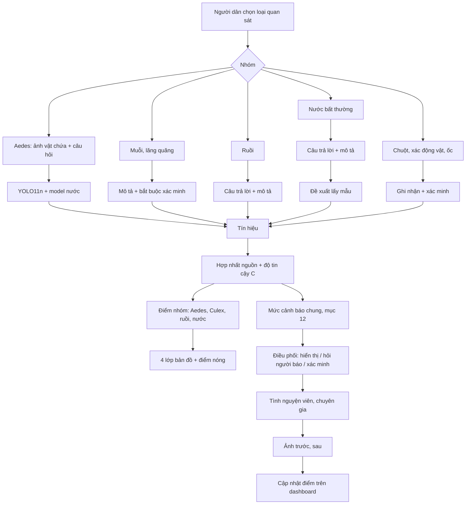

# Module AquaPulse Vector Watch

Sinh vật truyền bệnh và chỉ thị rủi ro sức khỏe môi trường.

Nguồn sự thật là code: danh mục nhóm, câu hỏi, cách xử lý, người xác minh và giới hạn của từng
nhóm nằm trong [`backend/app/vector_watch.py`](../backend/app/vector_watch.py), và được trả ra
qua `GET /vector-watch/catalog`. Form báo cáo và dashboard đọc từ đó, nên tài liệu này mô tả, còn
code quyết định.

## 1. Danh mục nhóm theo dõi

| Tầng | Nhóm (`vector_group`) | Miền (`risk_domain`) | Lớp bản đồ |
|---|---|---|---|
| A | Nước đọng, vật chứa: điều kiện Aedes (`aedes_breeding_risk`) | vector | Nguy cơ muỗi sinh sản |
| A | Muỗi hoặc lăng quăng (`mosquito_activity`) | vector | Nguy cơ muỗi sinh sản |
| A | Ruồi tập trung (`fly_cluster`) | sanitation | Ruồi, rác hữu cơ, vệ sinh |
| A | Váng, bọt, nước đổi màu, mùi lạ (`water_quality_signal`) | water_quality | Tín hiệu nước bất thường |
| B | Nước tù, cống rãnh: điều kiện Culex (`culex_environmental_risk`) | vector | Nguy cơ muỗi sinh sản |
| B | Chuột đô thị (`rodent_sighting`) | sanitation | Ruồi, rác hữu cơ, vệ sinh |
| B | Xác động vật (`dead_animal`) | sanitation | Ruồi, rác hữu cơ, vệ sinh |
| B | Ốc hoặc sinh vật nước (`aquatic_species`) | aquatic | Tín hiệu nước bất thường |
| C | Nhóm khác, chỉ ghi nhận (`other_reference`): Anopheles, ruồi cát, ruồi đen, ve, bọ chét, vi khuẩn, tảo độc | reference | — |

Tầng C được lưu để chuyên gia tham khảo, **không bao giờ được chấm điểm tự động**. Ảnh điện thoại
cho thấy được vật chứa, rác, nước đọng và dấu hiệu bề mặt, nhưng không đủ để xác định vi khuẩn,
độc tố hay chính xác loài muỗi.

## 2. Form riêng cho từng nhóm

Người dân chọn nhóm trước, rồi ứng dụng chỉ hỏi các câu của nhóm đó, cộng ba câu chung (gần nơi
nào, ai tiếp xúc, mưa gần đây):

| Nhóm | Câu hỏi riêng |
|---|---|
| Aedes | Có nước đọng? Trong vật gì (lốp xe, chai lon, xô chậu, hộp nhựa, hốc cây…)? Có rác, lá mục? Đọng bao lâu? Có sinh vật nhỏ chuyển động? |
| Muỗi, lăng quăng | Thấy gì? Ở đâu? Mật độ? |
| Ruồi | Mật độ? Rác hữu cơ? Xác động vật hoặc phân? Mùi? Gần chợ, quán ăn? |
| Nước bất thường | Màu nước? Có bọt? Mùi? Cá chết hoặc động vật tiếp xúc? |
| Culex | Nước đọng? Vật chứa? Lá mục? Mùi? Rác hữu cơ? |
| Chuột | Mật độ? Thấy ở đâu? Rác hữu cơ? |

## 3. Dữ liệu và model hiện có (nói thật)

| Nhóm | Đang dùng | Dữ liệu hiện có |
|---|---|---|
| Aedes | YOLO11n (vật chứa) + YOLO11s-seg (nước trong vật chứa) + Qwen3-VL tùy chọn | VisText-Mosquito, 1.640 ảnh. **Lớp lốp xe chưa kiểm chứng** trên ảnh thật; model nước chỉ 89 ảnh |
| Muỗi, lăng quăng | Người báo + Qwen3-VL mô tả | **Không có model côn trùng** |
| Ruồi | Người báo + Qwen3-VL mô tả | **Chưa có dataset cụm ruồi** |
| Nước bất thường | Người báo + Qwen3-VL mô tả | **Chưa có dataset váng, bọt** |
| Culex | Model vật chứa (miệng cống) + model nước + số báo cáo lặp lại | Không có dataset riêng |
| Chuột, xác động vật, ốc | Chỉ ghi nhận | Không có model |

Bảng model trong đề xuất ban đầu ghi YOLO cho ruồi, chuột và váng/bọt; các model đó **chưa tồn tại**
vì chưa có dữ liệu. Chúng sẽ được thêm khi nhóm thu thập đủ ảnh.

## 4. Luật tính điểm từng nhóm

Trọng số giữ nguyên theo đề xuất:

```text
aedes   = 0.35·nước đọng + 0.25·vật chứa + 0.15·rác hữu cơ + 0.15·mưa + 0.10·gần dân cư
          (+0.15 nếu nước đọng trong lốp xe; +0.10 nếu nước đọng trên 7 ngày; tối đa 1)
culex   = 0.30·nước tù bẩn + 0.25·rác hữu cơ + 0.20·mùi hôi + 0.15·cống tắc + 0.10·báo cáo lặp lại
ruồi    = 0.35·cụm ruồi + 0.30·rác hữu cơ + 0.20·xác động vật hoặc phân + 0.15·mùi hôi
nước    = 0.30·màu bất thường + 0.25·bọt + 0.25·váng dầu + 0.20·mùi hôi
```

Bốn chỗ khác bản đề xuất, mỗi chỗ vì một lỗi đo được:

1. **Không nhân điểm với độ tin cậy** (`final_score = raw_score × confidence`). Ở mục 12, cách
   này đã làm lốp xe cạnh trường học tụt từ Cam xuống Xanh chỉ vì người báo là người mới. Độ tin
   cậy C được báo bên cạnh điểm.
2. **Yếu tố chưa biết không tính là 0.** "Chưa có dữ liệu mưa" không có nghĩa là "không mưa".
   Yếu tố thiếu được bỏ ra, các trọng số còn lại được chia lại. Điểm dựa trên dưới 60% công thức
   bị đánh dấu "chưa đủ dữ liệu".
3. **Không có nước đọng thì điểm Aedes tối đa 0,3.** Công thức cộng vẫn cho 0,65 khi không có
   nước (vật chứa + mưa + gần nhà). Trên dữ liệu demo, một điểm đã đổ nước chỉ giảm từ 0,70 xuống
   0,61. Sau khi chặn: 0,70 → 0,30.
4. **Dấu hiệu chỉ model mô tả thấy thì tính là 0** cho tới khi có nguồn khác xác nhận. Trên ảnh
   thật, Qwen3-VL-2B đã khẳng định có váng dầu trên nước sạch.

Hai dòng được đánh dấu *bổ sung* (đề xuất không có công thức): nước đọng trên 7 ngày cộng 0,10
(đủ một vòng đời muỗi), và công thức riêng cho nhóm muỗi và nhóm chuột.

Mỗi báo cáo lưu `risk_domain`, `vector_group`, `group_score`, `vector_breeding_risk`,
`environmental_signal`, `human_contact_risk` và `confidence`, đúng như đề xuất. Mức cảnh báo
Xanh/Vàng/Cam/Đỏ vẫn do công thức chung của mục 12 quyết định.

## 5. Quy trình xác minh

| Nhóm | Ai xác minh |
|---|---|
| Aedes, Culex, ruồi | Tình nguyện viên, khi nghi có lăng quăng hoặc mức cam, đỏ |
| Muỗi, lăng quăng | Tình nguyện viên, **bắt buộc** với mọi báo cáo |
| Nước bất thường | **Chuyên gia hoặc phòng thí nghiệm lấy mẫu**, khi tín hiệu từ 0,5 |
| Chuột | Cộng đồng xác minh, bắt buộc |
| Xác động vật, ốc, tầng C | **Chuyên gia**, bắt buộc |

Người xác minh gửi **ảnh trước và sau** xử lý (`POST /verification/tasks/{id}/photos`). Ảnh
"sau" được chấm lại bằng đúng luật của nhóm, và dashboard hiện điểm trước → sau.

## 6. Dashboard

`/dashboard` hiển thị bốn lớp bản đồ như đề xuất: nguy cơ muỗi sinh sản; ruồi, rác hữu cơ, vệ sinh;
tín hiệu nước bất thường; điểm đã xác minh và can thiệp. Kèm theo là các điểm nóng theo từng lớp,
và bảng *Khu vực · Nhóm · Tín hiệu · Rủi ro · Tin cậy · Trạng thái* (trạng thái gồm "Cần xác
minh", "Cần lấy mẫu", "Đã xác minh, đã xử lý"…). Toạ độ được làm tròn khoảng 11 m.

## 7. Giới hạn chuyên môn của từng kết quả

| Nhóm | Hệ thống **không** kết luận |
|---|---|
| Aedes | Có muỗi hay lăng quăng; ảnh chỉ cho thấy điều kiện sinh sản |
| Muỗi | Loài muỗi. Kết quả chỉ là "nghi ngờ có hoạt động của côn trùng gần điểm nước đọng" |
| Ruồi | Số lượng chính xác; mật độ là ước tính của người báo |
| Nước bất thường | Vi khuẩn hay độc tố; chỉ phòng thí nghiệm xác nhận được |
| Chuột, ốc | Loài hay mầm bệnh |
| Tầng C | Bất cứ điều gì; chỉ lưu để tham khảo |

Mọi câu hệ thống sinh ra đều đi qua bộ lọc phạm vi của mục 1, có test kiểm tra.

## 8. Sơ đồ module



## Kịch bản demo (đã chỉnh cho khớp hệ thống thật)

Bản đầy đủ theo từng phút, có số liệu đo trên hệ thống: [demo-script.md](demo-script.md).

Dữ liệu demo tạo bằng `python backend/scripts/seed_demo.py --clear`. Ảnh là ảnh tập test thật,
chạy qua pipeline thật; vị trí, người báo và câu trả lời là giả, gắn cờ `is_demo`.

1. Người dân chụp **chậu, xô có nước** (không phải lốp xe: lớp lốp xe chưa kiểm chứng) và chọn
   "Nước đọng, vật chứa".
2. **YOLO11n khoanh vật chứa, model phân vùng tô vùng nước bên trong vật chứa.** (Đề xuất gốc ghi
   "YOLO phát hiện nước đọng"; thực tế đây là hai model khác nhau.)
3. Qwen3-VL (tùy chọn, chạy trên máy) mô tả bối cảnh.
4. Ba người khác báo **ruồi quanh bãi rác cách khoảng 300 m**.
5. PostGIS + DBSCAN gom thành cụm theo từng lớp.
6. Rule engine cho điểm nhóm Aedes và mức cảnh báo chung; báo cáo vào hàng đợi xác minh.
7. Chuyên gia xác nhận; ảnh sau xử lý cho điểm **0,70 → 0,30** trên dashboard.

## Nội dung cho hồ sơ dự thi

**Problem.** Urban residents often notice standing water, mosquito activity, fly clusters, organic
waste and unusual water conditions, but these observations remain fragmented and are difficult to
translate into timely environmental action.

**Solution.** AquaPulse Vector Watch converts citizen observations into structured One Health
signals. It combines on-device image analysis, the reporter's answers, geospatial clustering and
human verification to identify conditions associated with vector breeding and ecosystem-health
risks, one group of organisms at a time.

**AI safety.** The system does not diagnose disease or identify pathogens, toxins or mosquito
species from images. It estimates environmental risk, never lets a vision-language model raise a
score on its own, and routes low-confidence or high-impact cases, including every mosquito report
and every unusual-water report, to volunteers and experts. Every decision is logged with who made it.

**What is trained today.** A container detector (YOLO11n, 1,640 images) and a water-in-container
segmenter (YOLO11s-seg, 89 images). Fly, rodent, foam and oil-sheen signals come from the reporter
and are verified by people until datasets exist.

**Impact.** Earlier detection of standing water; prioritised verification; community participation;
measured before/after effect of clean-ups; a link between ecosystem, animal and human health.
